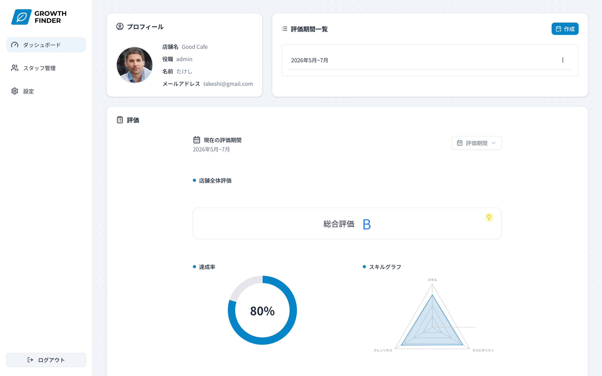
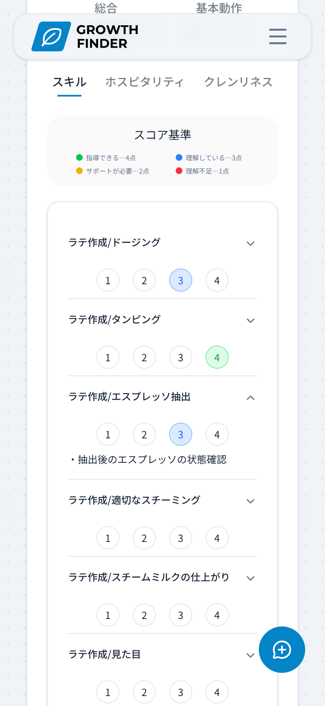
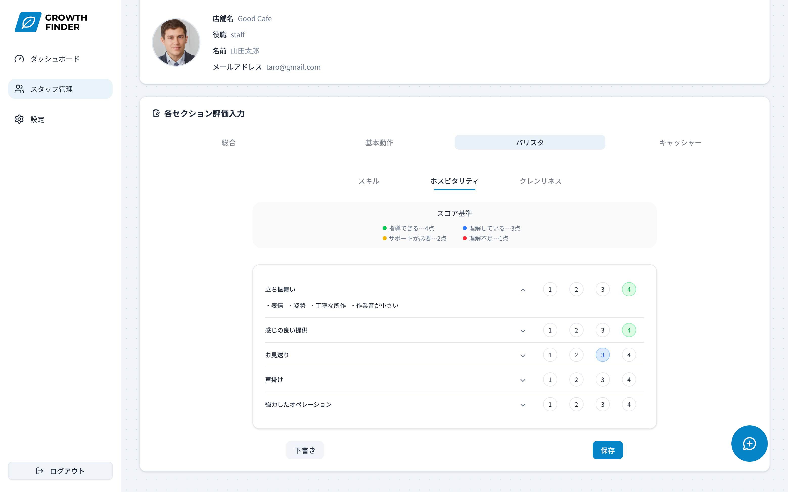
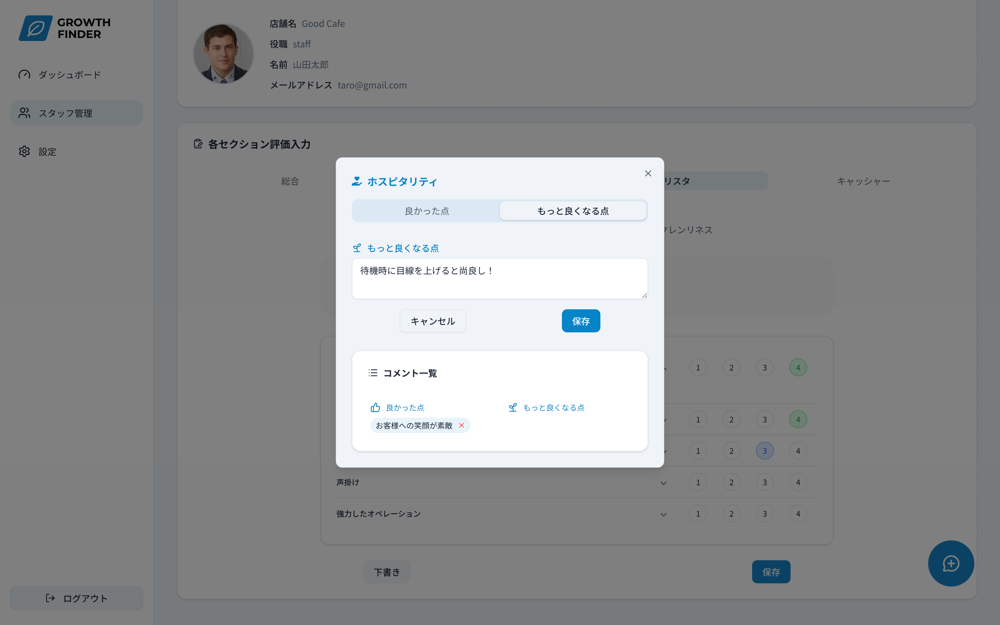
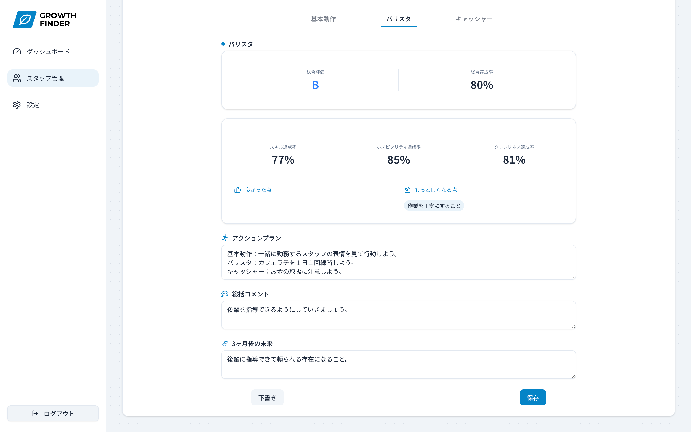
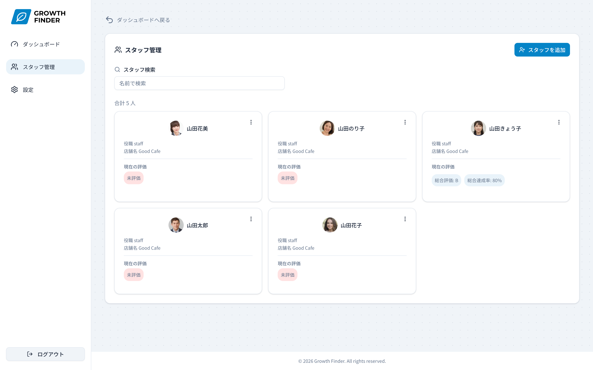
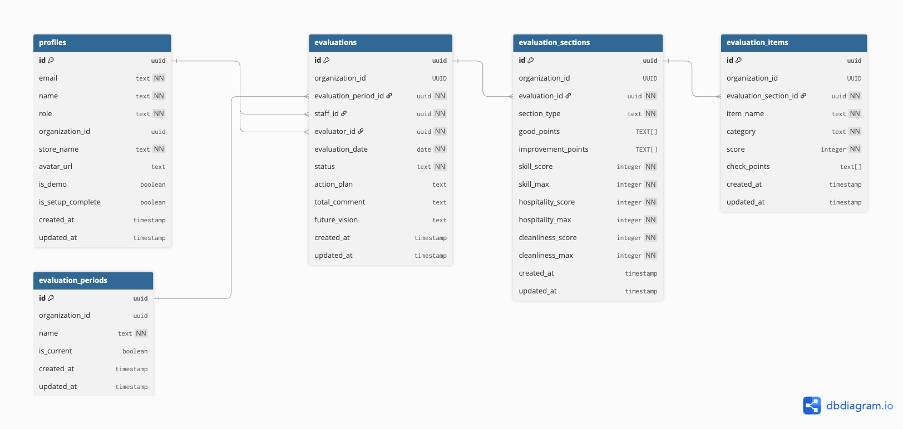
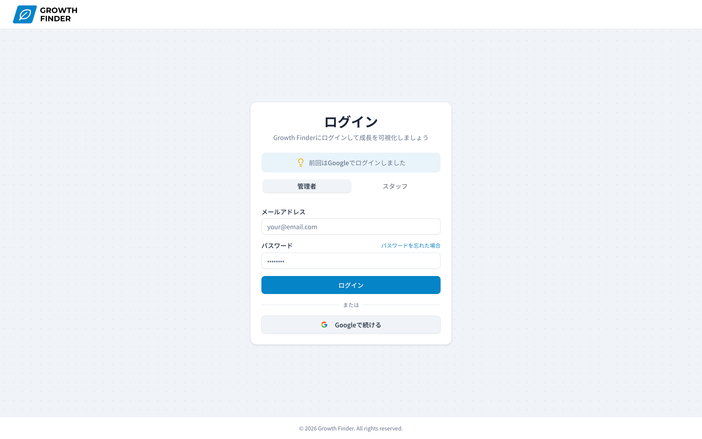
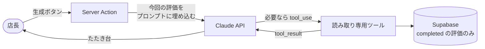

# Growth Finder

> スタッフの成長を可視化し、店長とスタッフの関係性構築を支援する人材育成ツール

[](https://nextjs.org/)
[](https://react.dev/)
[](https://www.typescriptlang.org/)
[](https://supabase.com/)
[](https://vercel.com/)



https://github.com/user-attachments/assets/7048cab6-717d-4a6a-a735-e344a159e431

---

## デモを試す

デモアカウントの登録は不要です。ファーストビューの **「デモで今すぐ試す」** ボタンから、
ワンクリックでアプリを体験できます。

**デモサイト**: https://growth-finder-psi.vercel.app/

> デモ環境では、評価入力・履歴閲覧・ランク算出など主要機能をお試しいただけます。
> アカウント登録なしで、面接・カジュアル面談中にもすぐご確認いただけるよう設計しました。

---

## 目次

- [プロジェクト概要](#プロジェクト概要)
- [開発背景](#開発背景)
- [主な機能](#主な機能)
- [技術スタックと選定理由](#技術スタックと選定理由)
- [システム設計](#システム設計)
- [設計上の試行錯誤](#設計上の試行錯誤)

---

## プロジェクト概要

**Growth Finder** は、カフェなどの飲食店におけるスタッフ育成を支援する Web アプリケーションです。

カフェ店長として 13 年の現場経験から生まれた「伸びしろ発見チェックシート」をデジタル化し、スタッフの成長を可視化・共有することで、店舗全体のレベル向上と、店長・スタッフ間の信頼関係構築を目指します。

### なぜ「評価」ではなく「関係性構築」のツールなのか

カフェのスタッフの多くは学生アルバイトで、本業は学業です。働く動機も「お金のため」「社会勉強」「カフェへの憧れ」など様々で、仕事へのモチベーションは構造的に高くなりにくい環境にあります。

だからこそ、一方的に評価して点数をつけるだけでは現場は動きません。関係性を築き、本人の成長を認め、承認欲求に応えることが大事です。それが結果として QHC(Quality / Hospitality / Cleanliness)の向上につながる、というのが 13 年の現場で得た実感です。

Growth Finder は単なる評価システムではなく、**店長とスタッフの関係性を構築し、信頼の土台を作るためのツール**として設計しています。

---

## 開発背景

### 現場で感じた 3 つの課題

カフェ店長として日々スタッフと向き合う中で、以下の課題を強く感じていました。

1. **スタッフが思うように動いてくれない**
2. **スタッフ自身が「自分の何が成長したのか」を実感しにくい**
3. **1on1 の場で「何を話すか」のきっかけが作りにくい**

### アナログ運用時代

そこで、QHC(Quality / Hospitality / Cleanliness)の評価フレームワークを基に、自分で **「伸びしろ発見チェックシート」** を Excel で作成しました。

- [開発コンセプトスライド](./docs/concept-slides.pdf) ― なぜこのツールを作ったのか
- [伸びしろ発見チェックシート](./docs/growth-finder-sheet.pdf) ― 自作したツール(印刷用)

実際に現場で運用したところ、スタッフとの 1on1 の質は大きく向上しました。
そして何より大きかったのは、スタッフの成長を具体的に承認できるようになったことです。自分の成長を認められることで、スタッフ自身に「もっとがんばろう」という意識が芽生えました。評価そのものよりも、この変化こそが現場にとって本当の価値でした。

### アナログ運用の限界

ただ、運用を重ねるうちに別の課題も見えてきました。

| 課題                       | 具体例                                                           |
| -------------------------- | ---------------------------------------------------------------- |
| **データの一元管理が困難** | スタッフ毎の紙シートが店舗に散らばる                             |
| **集計・可視化に手間**     | スタッフ全体の傾向や本人の成長曲線を、手作業で集計する必要がある |
| **紙ゆえの物理的な脆さ**   | カフェの仕事場では、紙が破れたり水に濡れたりする                 |
| **評価に時間がかかる**     | 1 人あたり約 2 時間（面談 30 分・評価 30 分・まとめ 1 時間）。30 名で 1 回あたり約 60 時間 |

便利だが手間のかかる運用を、もっと快適にしたい。そう考えて Excel で作ったツールを Web アプリケーションとして作り直しました。これが Growth Finder です。

---

## 主な機能

実際の画面とともに、コアとなる機能を紹介します。

### モバイルファーストの評価入力

カフェの仕事場に PC を持ち込むのは、場所の都合で現実的ではありません。そのため、店長がタブレットやスマートフォンで片手でも入力できることを最優先に設計しました。ネストタブ UI で 4 カテゴリ ×3 観点を切り替えながら評価でき、タブを切り替えても入力データは保持されます。

https://github.com/user-attachments/assets/9fb44b26-97fc-4050-8c9a-cf192c3c62ea





### その場で残せるフィードバック

気づいたことを鮮度の良いうちに記録できるよう、画面に追随するボタンからモーダルを開き、「良かった点」「もっと良くなる点」を瞬時にコメントできます。



### 自動ランク算出と対話のためのサマリー

評価点から総合ランクを自動算出。アクションプランや「3 ヶ月後の未来」まで記録でき、評価で終わらせず**次の対話につなげるツール**として設計しています。



### スタッフ管理

スタッフの追加・検索・評価状態の一覧確認ができます。



### AI による 1on1 フィードバックのたたき台

店長が入力した評価をもとに、1on1 面談で伝えるフィードバックのたたき台を AI が作ります。必要に応じて前回の評価や長期の傾向を取得し、「どこが伸びたか」を具体的に承認する文章にします。

評価するのは店長で、AI は文章を整えるだけです。設計の詳細は「設計上の試行錯誤」の 3 に記載しています。

https://github.com/user-attachments/assets/9178a6b5-8b21-40e9-9a09-cda8e66f42a6

<details>
<summary>その他の実装機能（クリックで展開）</summary>

- **認証・権限管理**: Supabase Auth（メール+パスワード / Google OAuth / パスワードリセット）、ロールベースアクセス制御、Next.js Middleware によるルート保護
- **評価機能**: react-hook-form + Zod、下書き保存（draft/completed）、評価期間管理
- **集計・可視化**: カテゴリ別達成率の自動計算、Recharts によるレーダーチャート・ドーナツチャート
- **育成支援**: アクションプラン・総括コメント・3 ヶ月後の目標の記録
- **品質**: ESLint / Vitest / GitHub Actions（CI/CD）

</details>

---

## 技術スタックと選定理由

### なぜ SPA ではなく Next.js か

本アプリは業務ツールで SEO が不要なため、当初は SPA も検討しました。最終的に Next.js (App Router) を選んだのは、次の 2 点が決め手です。

1. **型の一貫性とサーバー処理を、一体で得られる**
   サーバー・クライアント間の型の一貫性も、サーバー側でのデータ処理も、バックエンド (Hono) + フロントエンド (Vite + React) を TypeScript で統一する構成で実現できます。ただしそれは、環境構築と 2 つのアプリを管理するコストを伴います。Next.js はそれを最初から一体で提供します。一人で開発し、フロントとバックを分けて運用する必要のない本アプリの規模では、分離によるコストよりも一体性のメリットが上回ると判断しました。

2. **ロール判定とルート保護を一箇所で管理できる**
   管理者とスタッフの 2 種類のロールがあり、遷移できる画面が異なります。App Router の middleware で、ロール判定とルート保護を一箇所に集約できます。認可のルールが一箇所にまとまっているため、仕様変更時にも修正漏れが起きにくい構成です。

### その他の技術選定

| 技術                                 | 選定理由（要点）                                                                                                   |
| ------------------------------------ | ------------------------------------------------------------------------------------------------------------------ |
| **TypeScript**                       | `SectionType = 'basic' \| 'barista' \| 'cashier'` のようなユニオン型でドメインの状態を表現し、バグを未然に防ぐため |
| **React 19**                         | Server Components と `use()` API による非同期データ受け渡しなど、最新パターンを実践するため                        |
| **Tailwind CSS + shadcn/ui**         | デザインシステム構築の工数を抑えつつ、コンポーネントを自分のリポジトリで管理できる柔軟性のため                     |
| **react-hook-form + Zod**            | サーバー/クライアントで同一スキーマを共有できるバリデーション設計のため                                            |
| **Recharts**                         | 成長曲線の可視化に。React との統合がスムーズなため                                                                 |
| **Supabase / PostgreSQL**            | 認証・DB・Row Level Security が一体化。3 層構造の正規化を RDB で厳格に管理するため                                 |
| **Vercel**                           | Next.js との親和性が高いため                                                                                       |
| **Anthropic Claude API (Haiku 4.5)** | 評価を承認の言葉に変換するタスクで高度な推論を要さないため、速度とコストに優れる Haiku を採用。ツール呼び出しを繰り返すエージェントループの資料が一貫しているため |
| **Docker**                           | ローカル環境の再現性確保のため                                                                                     |
| **GitHub Actions / ESLint / Vitest** | PR 時に自動で Lint・テストを実行し、品質を担保するため                                                             |

---

## システム設計

### アーキテクチャ図


### データベース設計(ER 図)



### 画面遷移図


---

## 設計上の試行錯誤

| テーマ                 | 結論                                                   |
| ---------------------- | ------------------------------------------------------ |
| 1. DB とフォームの型   | 構造を無理に揃えず、境界で整形する                     |
| 2. 認証フロー          | URL の秘匿に頼らず、認証ロジックでなりすましを防ぐ     |
| 3. AI フィードバック   | AI に評価させず、役割分担を実装の構造で守る            |

### 1. DB 層とフォーム層の境界での型整形

DB から取得した評価データの構造と、react-hook-form が扱うフォームの構造は形が異なります。これをどう繋ぐかを考える中で、「データ構造の設計」「型の付け方」「自動生成型の限界」という 3 つの判断に向き合いました。

#### 1-1. なぜ DB の形にフォームを「揃えなかった」のか

**結論から言うと、両者を無理に一致させず、境界で整形する設計にしました。**

DB からは `.select` のネストで、`evaluation_sections` が**配列**として返ってきます。一方フォームは、`basic` / `barista` / `cashier` をキーに持つ**オブジェクト**で扱いたい。この 2 つの構造をどう繋ぐかで、2 つの選択肢がありました。

<details>
<summary>DB の構造とフォームの構造（クリックで展開）</summary>

**DB の構造（.select の 3 階層ネスト）**

```typescript
.select(
  `
    id, status, action_plan, total_comment, future_vision,
    evaluation_sections (
      id, section_type, good_points, improvement_points,
      skill_score, skill_max,
      hospitality_score, hospitality_max,
      cleanliness_score, cleanliness_max,
      evaluation_items ( item_name, category, score )
    )
  `
)
```

**フォームの構造（basic/barista/cashier をキーに持つオブジェクト）**

```typescript
{
  basic:   { skill: {}, hospitality: {}, cleanliness: {}, good_points: [], improvement_points: [] },
  barista: { skill: {}, hospitality: {}, cleanliness: {}, good_points: [], improvement_points: [] },
  cashier: { skill: {}, hospitality: {}, cleanliness: {}, good_points: [], improvement_points: [] },
  action_plan: '', total_comment: '', future_vision: '',
}
```

</details>

**選択肢 A：フォームを DB に合わせて配列にする**

この場合、2 つのデメリットが生じます。

- 「配列の 0 番目は basic」という暗黙のルールが生まれる
- `setValue` のパスを `sections.0.skill.xxx` とインデックスで指定する必要がある

特に 2 点目が問題でした。評価項目を扱う `EvaluationItem` コンポーネントは、複数カテゴリ・項目を共通ロジックで処理するため、`setValue` のパスをテンプレートリテラルで動的に組み立てます。

```typescript
setValue(`${sectionType}.${category}.${item_name}`, score);
```

オブジェクト構造なら `sectionType = 'basic' | 'barista' | 'cashier'` をそのままパスに使えます。配列だと「basic は 0 番目、barista は 1 番目…」というマッピングをコンポーネント側で持つ必要があり、複雑になります。

**選択肢 B：それぞれの都合に合わせ、境界で整形する（採用）**

DB の構造は DB の都合、フォームの構造は UI の都合です。無理に揃えず、取得時に整形をかける形にしました。こうすることで両者が疎結合になり、**DB の構造を変えてもフォーム側を変えずに済む**（その逆も同様）という保守性のメリットが得られます。

#### 1-2. `as` キャストをやめ、型と実体を一致させる

**当初は `as` で型を「主張」していましたが、それは型チェックを黙らせているだけだと気づき、型と実体が一致する書き方に直しました。**

当初の実装では、reduce の初期値に空オブジェクト `{}` を渡し、`as FormattedEvaluation` で型を主張していました。動作はしていましたが、TypeScript の学習を進める中で、`as` キャストは**型チェックを黙らせる手段でしかない**と理解しました。

```typescript
const result = existingEvaluation.evaluation_sections.reduce((acc, cur) => {
  acc[cur.section_type] = {
    ...formatCategoryScores(cur.evaluation_items),
    good_points: (cur.good_points ?? []) as string[],
    improvement_points: (cur.improvement_points ?? []) as string[],
  };
  return acc;
}, {} as FormattedEvaluation);
```

この書き方では、初期値の `{}` を「`FormattedEvaluation` だ」と強引に主張しているだけで、実際に `basic` / `barista` / `cashier` が揃っているかは**保証されません**。reduce の処理でプロパティが追加される前提に依存しており、もし処理に不備があっても**型エラーで気づけない**状態でした。

そこで、reduce にジェネリクス型引数 `<FormattedEvaluation>` を渡して返り値の型を宣言し、初期値も `EMPTY_SECTION_DATA` で必須プロパティを揃えることで、**型と実体を一致させました**。

<details>
<summary>書き直した実装（クリックで展開）</summary>

```typescript
const EMPTY_SECTION_DATA: SectionData = {
  skill: {},
  hospitality: {},
  cleanliness: {},
  good_points: [],
  improvement_points: [],
};

export const formatEvaluationData = (
  existingEvaluation: ExistingEvaluation
) => {
  const result =
    existingEvaluation.evaluation_sections.reduce<FormattedEvaluation>(
      (acc, cur) => {
        acc[cur.section_type] = {
          ...formatCategoryScores(cur.evaluation_items),
          good_points: cur.good_points ?? [],
          improvement_points: cur.improvement_points ?? [],
        };
        return acc;
      },
      {
        basic: { ...EMPTY_SECTION_DATA },
        barista: { ...EMPTY_SECTION_DATA },
        cashier: { ...EMPTY_SECTION_DATA },
      }
    );
  return result;
};
```

</details>

#### 1-3. 自動生成型の限界 ― AI コーディングで見落としやすい型崩れ

**Supabase が自動生成する型は、DB の CHECK 制約までは反映しません。そのため、アプリケーション側で型を絞り直す必要がありました。**

Supabase は `.select` の結果から型を自動生成してくれます。しかし、この型は DB の CHECK 制約を反映しません。

例えば `evaluation_sections.section_type` は、DB 側で `CHECK (section_type IN ('basic', 'barista', 'cashier'))` の制約をかけています。それでも、自動生成される型は `string` のままです。そこでアプリケーション側で `SectionType = 'basic' | 'barista' | 'cashier'` を定義し、整形時に型を絞り込みました。

この「自動生成型が `string` で返ってくる」点は、**AI にコードを生成させているとそのまま通り過ぎてしまいやすい**箇所です。動作はするため、型の穴に気づかないまま進んでしまう。自動生成型の限界をあらかじめ理解していたことで、自分で型を絞り直す判断ができました。

#### このセクションで得た設計判断としての学び

- **DB の構造とアプリケーションの構造は、無理に一致させる必要はない。** 境界で整形することで両者を疎結合に保て、片方の変更がもう片方に波及しない
- **`as` キャストは型を「主張」するだけで「保証」しない。** ジェネリクスや初期値で、型と実体を一致させる
- **自動生成型は万能ではない。** CHECK 制約のような情報は失われるため、必要に応じてアプリケーション側で型を絞り直す

---

### 2. 認証フローの設計 ― 1 つのログイン画面で 2 種類のロールを安全に扱う

**結論：想定する運用フローを定義した上で、そのフローを逸脱する経路（スタッフによる管理者なりすまし）を、既存の仕組みを再利用して塞ぎました。**

#### 想定する運用フロー

本アプリは、店長（管理者）とスタッフという役割の異なる 2 者が使います。アカウントの作られ方が非対称なのが特徴です。

1. **管理者**は自分でアカウントを作成する（メール / パスワード または Google OAuth）
2. **管理者**がスタッフのアカウントを代理で登録する
3. 管理者がスタッフに、ログインページの URL とパスワードを伝える
4. **スタッフ**はメールアドレスとパスワードでログインし、自分の評価を閲覧する

ここで重要なのは、**スタッフは自分でアカウントを作らない**という点です。スタッフのログインはメール+パスワードのみで、Google OAuth を使う必要がありません。

> **なぜスタッフを代理登録にしたのか**
> セキュリティ上はスタッフ自身がアカウントを作る方が望ましいですが、現場で「各自アカウントを作っておいて」と案内しても、作らない人が一定数います。評価したいときにアカウントが無いと業務が止まるため、確実に運用される代理登録を選びました。

#### 気づいた問題：スタッフが管理者になりすませる

この運用フローを前提にルーティングを確認していたところ、**スタッフが管理者タブの Google OAuth を使って、自分を管理者としてアカウント作成できてしまう**状態に気づきました。

管理者タブの「Google で続ける」ボタンは `signUpWithGoogle` を呼び、`role: 'admin'` を `user_metadata` に含めます。そのためスタッフが管理者タブで OAuth を実行すると、新規 admin として `profiles` レコードが作られ、`/admin` にアクセスできてしまう。本来スタッフに不要なはずの OAuth 経路が、抜け穴になっていました。



#### 検討した 2 つの選択肢

**選択肢 A：管理者用とスタッフ用でログイン URL を分ける**

`/admin-login`・`/staff-login` のように URL を分け、物理的にスタッフが管理者の OAuth ボタンを押せなくする案です。以下の理由で採用しませんでした。

- 管理者がスタッフに案内する URL が複数になり、混乱を招く
- 誤って管理者用 URL をスタッフに伝えると、URL 秘匿に頼った防御線が崩れる

特に 2 点目は実際に起こりえます。**URL の秘匿に頼る設計は、運用ミス 1 回で致命傷になりかねません。**

**選択肢 B：認証ロジックで OAuth フローの意図を判別する（採用）**

ログイン画面は 1 つのまま、OAuth のリダイレクト URL に「ログイン目的かサインアップ目的か」を示すパラメータ（`intent`）を付与し、callback 側で `intent` と `profiles` のデータを照合して不正なフローを弾く設計です。

- **運用面**：ログイン画面が 1 つで、スタッフへの URL 案内で混乱しない
- **セキュリティ面**：URL 秘匿に依存しないため、伝え間違いなどの運用ミスに強い
- **実装面**：管理者・スタッフでログイン画面を共有でき、コード量を抑えられる

#### 採用した設計：既存の仕組みを再利用して防御する

本アプリには、もともと UX 向上のために導入していた 2 つの仕組みがありました。

1. **intent パラメータ**：callback で「ログインかサインアップか」を判定し遷移先を分岐するクエリパラメータ（`intent=login` → `/admin`、`intent=signup` → `/setup`）
2. **is_setup_complete フラグ**：OAuth 作成直後、名前や店舗名が未入力で管理者として不完全な状態を示すフラグ

OAuth ではメールアドレスしか取得できないため、この 2 つを組み合わせ、ログイン直後にセットアップ画面へ自動誘導する設計にしていました。

今回の脆弱性に対しては、**新しい仕組みを作らず、この既存の 2 つを組み合わせて検証**することで解決しました。具体的には callback の `intent === 'login'` 分岐に、`profile.role === 'admin'` かつ `profile.is_setup_complete === true` の検証を追加しました。

<details>
<summary>callback の分岐ロジック（クリックで展開）</summary>

```typescript
if (intent === 'login') {
  const isValidAdmin =
    profile.role === 'admin' && profile.is_setup_complete === true;

  if (!profile.is_setup_complete) return; // セットアップ未完了はブロック
  if (!isValidAdmin) return; // 管理者以外はブロック
  return; // /admin へ
}

if (intent === 'signup') {
  if (profile.is_setup_complete) return; // 既存ユーザーは /admin へ
  return; // セットアップ未完了は /setup へ
}

return; // intent が無い場合は想定外フローなので /login へ
```

</details>

この検証により、スタッフが管理者タブから OAuth 認証しても `intent === 'login'` の分岐で弾かれます。**既存の仕組みに検証を一つ足すだけで、URL 秘匿に依存しない防御を実装できました。**

#### 設計の限界：スタッフのパスワード管理

代理登録の運用には弱点もあります。管理者がスタッフのパスワードを知っている状態であり、スタッフが自分で変更しない限りその状態が続きます。本来は初回ログイン時にパスワード変更を促す仕組みが望ましく、今後改善したい点です。

#### 設計判断としての学び

- **URL の秘匿に頼る設計は、運用ミス 1 回で致命傷になる。** 認証ロジックで判別する方が運用に強い
- **新機能を作る前に、既存の仕組みを再利用できないか考える。** 実装コストを下げられる
- **セキュリティの理想と現場運用の現実の、落としどころを決める。** 理想だけでは現場で使われない

---

### 3. AI フィードバックの設計 ― AI に評価させず、承認の材料を整える

**結論：評価するのは店長、AI は文章のたたき台を作るだけ。この役割分担を、運用ルールではなく実装の構造で守る設計にしました。**

#### 背景：まとめに時間を取られ、面談に時間を使えない

評価のあと、内容を振り返って面談で伝える言葉にまとめる作業に、1 人あたり約 1 時間かかっていました。30 名なら約 30 時間です。この「まとめ」を AI に任せ、店長が面談そのものに時間を使えるようにすることが目的です。

#### 3-1. なぜ「LLM を 1 回呼ぶだけ」ではなくエージェントにしたのか

最初はツールを持たせず、LLM を 1 回だけ呼びました。すると、評価データを渡していないのに「接客時の笑顔が好評です」という、もっともらしいフィードバックが返ってきました。**AI が評価をでっち上げている状態**であり、「AI は評価しない」というこのプロダクトの思想と真逆です。

また、承認には「過去と比べてどう伸びたか」が欠かせません。そこで、LLM 自身が必要に応じて過去の評価を取りに行くエージェントループにし、実データに基づいて文章を作るようにしました。

いきなり本実装に入らず、天気を取得するだけの小さなエージェント（[weather-agent](https://github.com/takeshi0518/weather-agent)）を別に作り、ツール呼び出しの往復を手で確かめてから組み込んでいます。



#### 3-2. 役割分担と権限

| 担い手           | 役割                                                     |
| ---------------- | -------------------------------------------------------- |
| 店長（人）       | QHC 評価・コメントの入力（評価そのものは AI に任せない） |
| ツール（コード） | 過去の completed 評価を客観的な事実として取得する        |
| LLM              | 過去との差を読み取り、承認の言葉に変換する（評価はしない） |

- **ツールは読み取り専用**：AI は評価を書き換えられない
- **ツールに引数を持たせない**：AI は対象スタッフを選べない。どのスタッフのデータを取るかはコード側で決まる
- **DB 層でも制限する**：ツールのクエリは組織 ID で絞り込み、RLS でも自組織のデータしか取得できない
- **反復に上限を設ける**：ツール呼び出しのループは最大 5 回
- **今回の評価はツールで取得しない**：画面に表示中の評価はプロンプトに直接埋め込み、往復を 1 回分減らしている

#### 3-3. なぜ AI の文章をスタッフに直接見せないのか

技術的には、生成した文章をスタッフのページに表示したり、そのまま送ったりするのは簡単です。それでもやらないのは、**AI の言葉は承認にならない**からです。

承認とは、自分を見ていた人に認められることです。毎日一緒に働き、努力を見てきた店長が「成長したね」と言うから意味があります。スタッフがページを開いて AI の文章を読んでも、それは承認ではなく通知です。

そのため AI は、店長が承認するための材料を整えるところで止まります。伝えるのは、面談の場で相手の表情を見ている店長です。人を入口と出口に置いているのは、安全性や精度のためだけではなく、そうしなければこのプロダクトの目的を果たせないからです。

<details>
<summary>集計・プロンプト・Server Action の判断と、コスト・生成時間の実測値（クリックで展開）</summary>

#### 3-4. 数値の集計はコードで行う

- LLM に計算はさせず、集計と傾向判定はコードで行う。LLM の計算は不正確になりうるうえ、過去の評価を全件渡すと在籍期間に比例してトークンが増えるため
- セクションごとに満点が違うため、点数ではなく達成率で比べる
- 傾向は、直近 3 件の平均とそれ以前の平均の差で判定する（`improving` / `stable` / `declining`）
- 判定の閾値は数値だけでは決められず、実際に生成される文章の自然さを見ながら調整した。厳しすぎると承認の機会を逃し、緩すぎると実態と離れて嘘っぽくなる

#### 3-5. プロンプト：否定形の指示は効かなかった

「前置きは不要」と否定形で指示しても、LLM は「データを確認しました。それでは作成します」という作業報告を出し続けました。「スタッフへの呼びかけから書き始めてください」と**書き出しを肯定形で指定**し、禁止事項を具体例つきで別の項目に分けたことで解消しました。

#### 3-6. Route Handler ではなく Server Action を選んだ理由

生成は LLM の呼び出しとコストが発生する、副作用のある操作です。過去にこのプロダクトで、副作用のある GET の Route Handler がプリフェッチされ、意図しないタイミングで実行される不具合を経験しました。そのため、POST として扱われる Server Action を選びました。

#### コストと生成時間（実測）

|                          | 実測値                               |
| ------------------------ | ------------------------------------ |
| 1 回の生成コスト         | 約 1.28 円（$0.0086 / 2 ターン）     |
| 生成時間（ローカル）     | 約 6.2 秒                            |
| 生成時間（本番 / Vercel） | 約 13.5 秒                           |

まとめに 1 人あたり約 1 時間かかっていた作業のたたき台が、約 13.5 秒で生成されます。店長が手直しする時間はまだ計測していません。

</details>

#### 既知の制約

- 評価が 1 件だけの新人は比較の材料がないため、今回の評価だけで文章を作る。存在しない成長を作らないための設計だが、承認の材料は少なくなる
- 「前回の評価」を、取得結果の 2 件目として扱っている。過去の評価期間を表示しているときは、その期間ではなく最新の評価を基準にした「前回」を取得してしまう
- 生成したフィードバックは保存していない

#### 設計判断としての学び

- **エージェントにするのは、機能を足すためではない。** AI の出力を実データにつなぎ、でっち上げを構造的に防ぐため
- **役割分担は運用ルールではなく、実装の構造で守る。** ツールの権限と引数で、AI ができることを最初から限定する
- **AI に任せる作業と、人が担う仕事を分ける。** AI で生まれた時間を、人にしかできない仕事へ回せる

---

## リンク

- **GitHub**: [@takeshi0518](https://github.com/takeshi0518)
- **Zenn**: [技術記事一覧](https://zenn.dev/takeshi0518)
- **X (Twitter)**: [@y_takeshi0518](https://x.com/y_takeshi0518)

---

## ライセンス

このプロジェクトは個人のポートフォリオ用途として作成されています。
